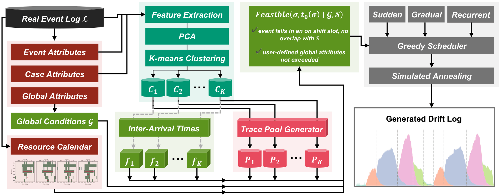

# RealDrift: Multi-Perspective Drift Generation from Real Event Logs

RealDrift turns a real event log into event streams with controlled and labelled concept drifts.
Real traces are grouped into concepts (trace clusters), a decoder produces a pool of traces per concept,
and a composer places the traces on a timeline so that resource calendars, resource capacity, arrival
behaviour and optional global conditions stay feasible. The ground truth of every drift is derived from
the final placements, so each stream comes with exact drift points or drift intervals.



## Installation

Python 3.10 or newer is recommended.

```bash
python -m venv .venv && source .venv/bin/activate
pip install -r requirements.txt            # add requirements-dev.txt for the tests
```

Two optional external repositories are needed for some steps. Neither is vendored here.

```bash
git clone https://github.com/konradoezdemir/AT-KDE.git external/AT-KDE
pip install -r external/AT-KDE/requirements.txt
export ATKDE_ROOT=$PWD/external/AT-KDE      

git clone https://github.com/perdikon/TF-decoder.git ../TF-decoder
export TF_DECODER_REPO_PATH=$PWD/../TF-decoder
```

AT-KDE is required for every composition run with `use_atkde: true`. TF-decoder is only needed to
train new decoders. The shipped Sepsis pools let you compose streams without it.

## Data

| Log | Source | Status in this repo |
|---|---|---|
| Sepsis | Mannhardt (2016), [4TU.ResearchData](https://doi.org/10.4121/uuid:915d2bfb-7e84-49ad-a286-dc35f063a460) | raw log, sublogs, pools and calendars included in `data/` |
| BPIC 2012 | van Dongen (2012), [4TU.ResearchData](https://doi.org/10.4121/uuid:3926db30-f712-4394-aebc-75976070e91f) | not included, see below |
| Emergency | private hospital log | not included, cannot be shared |

To use BPIC 2012, download the complete log, save it as `data/raw/BPIC12_complete.xes` and run
`scripts/prepare_dataset.py` (see below) to create the clusters and calendars. The trace pools
(`data/concept_pools/generated_bpic12_rank{1..5}{A,B}.csv`) are produced by the TF-decoder in step 4.

## Quick start

Compose one Sepsis stream with a sudden drift, using the shipped pools and calendars.

```bash
python generate_drift_log.py --config configs/sepsis_config.yaml \
    --tier sudden --seed 0 --out-dir outputs/demo --export-xes
```

The exit code is non-zero when validation fails. Useful options are `--tier {sudden,gradual,hard,recurrent}`,
`--max-beds N` (global bed-capacity condition), `--skip-sa` (greedy pass only), `--sa-iterations`,
`--gradual-window`, and `--max-cases-per-instance` (truncated pools for a smoke test).

## Pipeline

| Stage | Code | What it does |
|---|---|---|
| 1 | `src/step1_attribute_classification.py` | Classifies case attributes (based on López-Pintado et al.) |
| 2 | `src/step2_resource_calendars.py` | Discovers resource calendars (60-minute slots, thresholds `d_supp`, `d_conf`, `d_part`) |
| 3 | `src/step3_trace_clustering.py` | PCA and K-means, `cluster_fixed_k` with K from the config |
| 4 | `src/step4_trace_pool_generation.py` | Trains a TF-decoder per cluster (300 epochs) and generates the trace pools |
| 5 | `src/step5_arrival_time_modeling.py`, `src/atkde_adapter.py` | Arrival models with AT-KDE (`atkde_strict` fails instead of falling back to flat arrivals) |
| 6 | `src/step6_drift_composer.py` | Composer with preemption, gradual blending and simulated annealing |

`src/pipeline.py` wires stages 2, 5 and 6 together, `src/validation.py` checks every composition, and
`src/io_utils.py` holds the shared I/O helpers.

The composer works on a horizon of 21 days, allows at most 5 preemptions, blends gradual drifts over
w = 30 cases and refines placements with simulated annealing (3000 iterations, T0 of one hour, cooling 0.995,
shift, swap and snap moves). A case is excluded when no feasible time is found within the horizon. Excluded
cases are listed in `_excluded.csv` and counted in the manifest.

## Reproducing the paper

All commands run from the repository root. Steps marked *external* need the third-party code above.

1. **Prepare a dataset** (raw log to clusters, sublogs and calendars).
   ```bash
   python scripts/prepare_dataset.py --config configs/bpic2012_config.yaml [--silhouette-report]
   ```
   K comes from `n_clusters` in the config (BPIC 2012 K = 5, Emergency K = 4, Sepsis K = 2, chosen manually).
   The script compares new sublogs with existing ones using the adjusted Rand index.
2. **Generate trace pools** (*external*, TF-decoder). Each cluster needs an input folder
   `data_{dataset}_rank{N}/{subfolder}/{subfolder}.csv` plus `_TRAIN/_VAL/_TEST.csv` (`;` separated) in the format
   the TF-decoder expects.
   ```bash
   python src/step4_trace_pool_generation.py --repo-path $TF_DECODER_REPO_PATH --datasets sepsis
   ```
   The script that creates the TF-decoder input folders is not part of this repository.
3. **Calibrate the calendars.** `d_supp` decides how many real cases fit inside the discovered calendars.
   ```bash
   python scripts/calendar_diagnostics.py --config configs/bpic2012_config.yaml
   ```
   All configs use `d_supp = 0.99`.
4. **Compose all streams** (datasets x tiers x seeds, *external* AT-KDE).
   ```bash
   python scripts/run_composition.py --experiment configs/experiment.yaml --phase tune   # seeds 100 to 102
   python scripts/run_composition.py --experiment configs/experiment.yaml --phase eval   # seeds 0 to 4
   ```
   Datasets whose files are missing (for example Emergency) are skipped. Use `--datasets`, `--tiers`, `--seeds`
   and `--force` to restrict or redo runs.
5. **Tune and evaluate the detectors.**
   ```bash
   python -m evaluation.run_detection --phase tune
   python -m evaluation.run_detection --phase eval
   ```
   Tuning on the tuning seeds writes `outputs/tuned_params.yaml`. Evaluation reads it and writes
   `outputs/detection_raw.csv` and `outputs/detection_summary.csv`. The grid search can run for hours.
   Write its console log outside of cloud-synced folders, since blocked log writes can stall the run.
6. **Export the continual learning tasks** for COMPASS, see [below](#continual-learning-export).

## Drift tiers and ground truth

| Tier | Structure | Ground truth |
|---|---|---|
| sudden | Instance A to instance B, all transitions sudden | First start of the incoming instance |
| gradual | One A instance per task, gradual blending (w = 30) | Interval from the first start of the incoming to the last start of the outgoing instance |
| recurrent | A of all tasks, then B of all tasks, all sudden | 2K - 1 sudden points |
| hard | R1A, R1B, R2A, ... sudden within a task, gradual between tasks | Points and intervals |

## Drift detection evaluation

Two detectors are wrapped as registered detectors. Their code is copied into `evaluation/pelt_impl` and
`evaluation/vc_impl` (see the licence notes in the third-party section).

| Name | Module | Origin |
|---|---|---|
| `pelt` | `evaluation/detector_pelt.py` | Adams et al. (2023), feature series with PELT (window of `window_days`, max-normalised series). Change points of all features are pooled, those within `merge_windows` windows form one detection, and a detection needs `min_features` supporting features. |
| `vc` | `evaluation/detector_vc.py` | Version Clustering (Abarca Zúñiga et al., CAiSE 2026) with `n_windows`, `min_cluster_size` and `pen`. The timestamp of a detection is the first event of the first trace of the new version. |

Settings and tuning grids are in `configs/detectors.yaml`. Scoring (`evaluation/scoring.py`) uses optimal
one-to-one matching, a tolerance, interval ground truth for gradual drifts, and counts detector errors as
failures. The main tolerance is 2 percent of the stream's time span (`span2`). The configuration also
holds the sensitivity tolerances (14 days, and 0.5, 1 and 2 windows). Reported values are the mean and
sample standard deviation over the evaluation seeds.

Precision, recall, the selected hyperparameters and the tolerance sensitivity analysis are available in the
output CSVs and in `tuned_params.yaml` after you run the evaluation. They are not part of the paper.

## Continual learning export

```bash
python evaluation/export_cl_tasks.py outputs/streams/eval/bpic12_sudden_seed0 --out outputs/cl/bpic12_sudden_seed0.csv
```

writes the task-labelled events that are fed to COMPASS. Training and evaluating COMPASS is done with its own code.

## Third-party components and references

RealDrift builds on the following work. Code marked *not included* must be obtained from its authors.

| Component | Used for | Where in RealDrift | Reference |
|---|---|---|---|
| **PELT** (change point search) | Change point detection on feature series | `evaluation/pelt_impl`, included | Killick, Fearnhead and Eckley (2012). *Optimal detection of changepoints with a linear computational cost.* JASA 107(500). Process mining framework by Adams, Zimmermann, Kasra and van der Aalst (2023). *Explainable concept drift in process mining.* Information Systems 114. |
| **Version Clustering (VC)** | Drift detection with HDBSCAN on trace windows | `evaluation/vc_impl`, included under its MIT licence | Abarca Zúñiga, Yeshchenko and van der Aa (2026). CAiSE 2026. Code from `version-clustering-cdd`. |
| **COMPASS** | Continual learning evaluation on task-labelled streams | export in `evaluation/export_cl_tasks.py`, *not included* | van Straten and Hassani (2026). COMPASS. |
| **AT-KDE** | Arrival time model of step 5 | `src/atkde_adapter.py`, *not included* | Kirchdorfer et al. (2026). AT-KDE, https://github.com/konradoezdemir/AT-KDE |
| **TF-decoder** | Generating trace pools per cluster in step 4 | `src/step4_trace_pool_generation.py`, *not included* | Perdikogiannis et al. (2026). https://github.com/perdikon/TF-decoder |
| **Attribute classification** | Case and event attribute types in step 1 | `src/step1_attribute_classification.py`, adapted | López-Pintado et al. |
| **Resource calendar discovery** | Calendars in step 2 | `src/step2_resource_calendars.py` | López-Pintado et al. (2024) |
| **Sepsis log** | Dataset | `data/` | Mannhardt (2016). Sepsis Cases, Event Log. 4TU.ResearchData. |
| **BPI Challenge 2012** | Dataset | download only | van Dongen (2012). BPI Challenge 2012. 4TU.ResearchData. |
| **Emergency log** | Dataset | private | not available |

Please check the entries above against the final reference list of the paper before publishing,
in particular volume, page and URL details of COMPASS, VC and TF-decoder.

If you use one of these components through RealDrift, please cite the original work as well.

